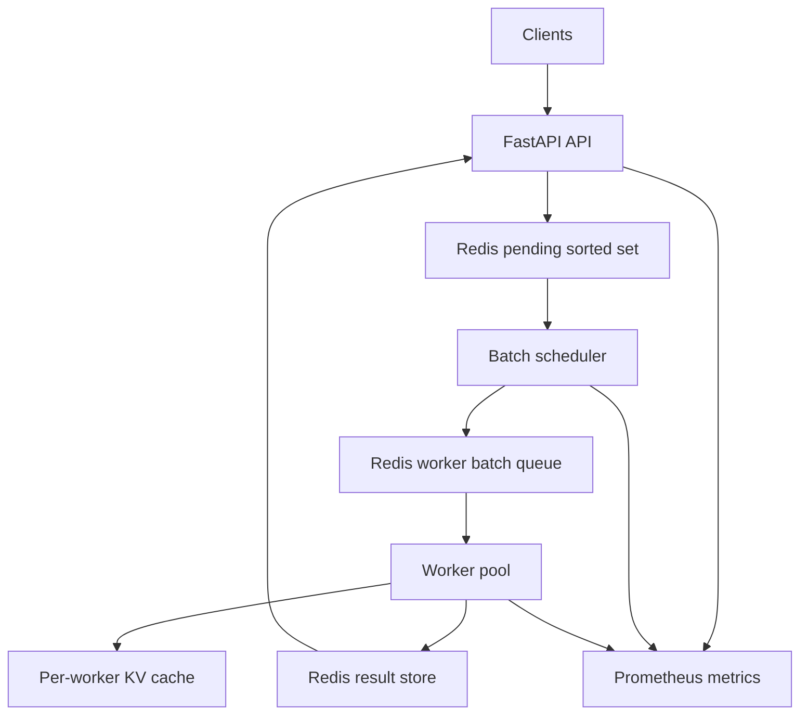

# LLM Inference Server

Architecture-first LLM inference server with FastAPI, Redis queues, dynamic batching, simulated KV-cache reuse, worker processes, and Prometheus/Grafana monitoring.

This v1 uses deterministic fake inference instead of a HuggingFace model. That keeps the distributed systems pieces easy to run on a laptop while still producing benchmarkable batching and cache-hit behavior.

## Architecture



## Run Locally

```bash
docker compose up --build
```

```bash
curl http://localhost:8000/health
```

```bash
curl -X POST http://localhost:8000/infer \
  -H "Content-Type: application/json" \
  -d '{"system_prompt":"You are concise.","prompt":"Explain batching.","max_tokens":128}'
```

Prometheus runs at `http://localhost:9090`; Grafana runs at `http://localhost:3000`.

Scale workers:

```bash
docker compose up --build --scale worker=2
```

## API

`POST /infer`

```json
{
  "prompt": "Explain batching.",
  "system_prompt": "You are concise.",
  "max_tokens": 128,
  "priority": 1,
  "timeout_ms": 10000
}
```

Response:

```json
{
  "request_id": "...",
  "response": "simulated-response-...",
  "latency_ms": 83.2,
  "cache_hit": false,
  "batch_size": 4
}
```

## Tests

```bash
pytest
```

## Load Test

```bash
locust -f load_test/locustfile.py --host http://localhost:8000
```

Use Locust to compare sequential-style settings such as `MAX_BATCH_SIZE=1` against batched settings like `MAX_BATCH_SIZE=4` and `MAX_BATCH_SIZE=8`.
